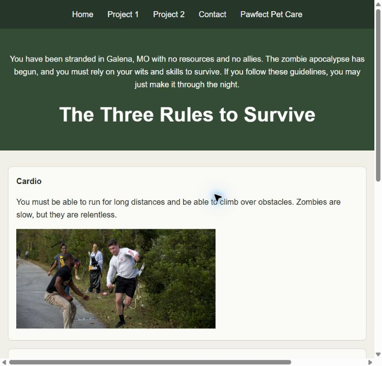

# Pawfect Pet Care

Lukas Alvarez · CIS 130 · Fall 2026

A single-page site for a fictional neighborhood pet care studio. Visitors can meet daycare and boarding guests in a photo gallery, compare daycare, grooming, and boarding, and find answers to common questions before a visit.

## Open the site

[Visit Pawfect Pet Care](https://www.ozarktechwebdev.com/fall26/lukasa/pawfectpetcare/)

Open `index.html` in a browser. The project includes its photographs and Bootstrap 5.3.3 files, so the gallery, navigation, and FAQs also work offline.

## Class landing page

Choose **Pawfect Pet Care** in the top navigation of [my class landing page](https://www.ozarktechwebdev.com/fall26/lukasa/).

## Project files

- `index.html` contains the page and its Bootstrap components.
- `styles.css` sets the colors, typography, photo crops, and responsive layout.
- `navigation.js` closes the mobile menu when a visitor selects a section.
- `assets/` contains the three photographs.
- `vendor/` contains Bootstrap and its license.

## Photographs

Photographs from Unsplash. [French bulldog](https://images.unsplash.com/photo-1583337130417-3346a1be7dee), [golden retriever](https://images.unsplash.com/photo-1552053831-71594a27632d), and [orange tabby](https://images.unsplash.com/photo-1573865526739-10659fec78a5).
